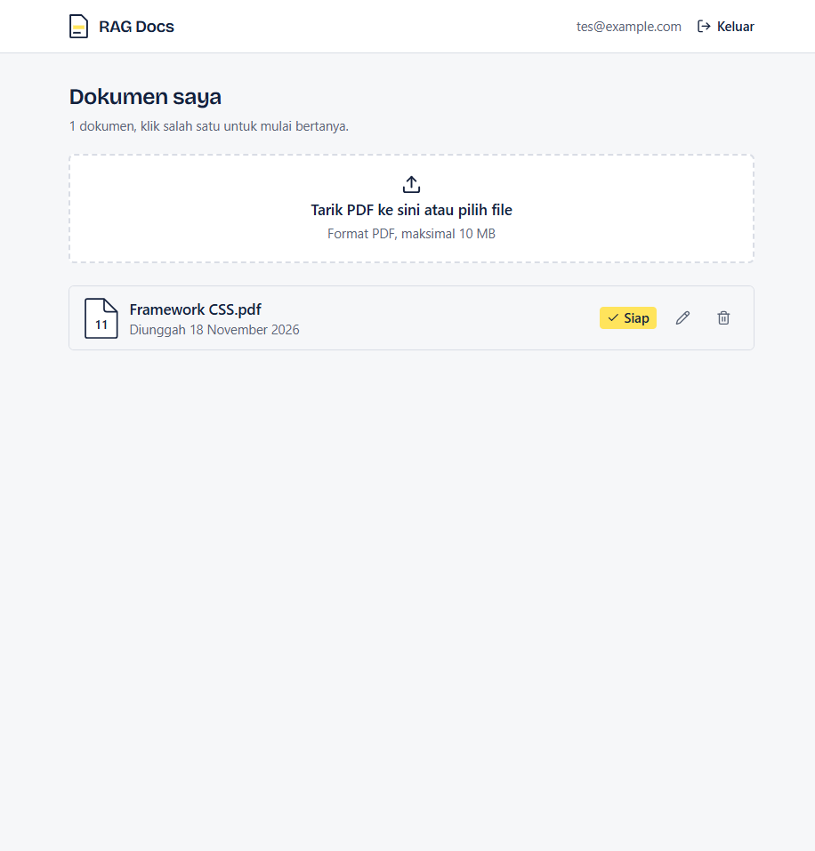
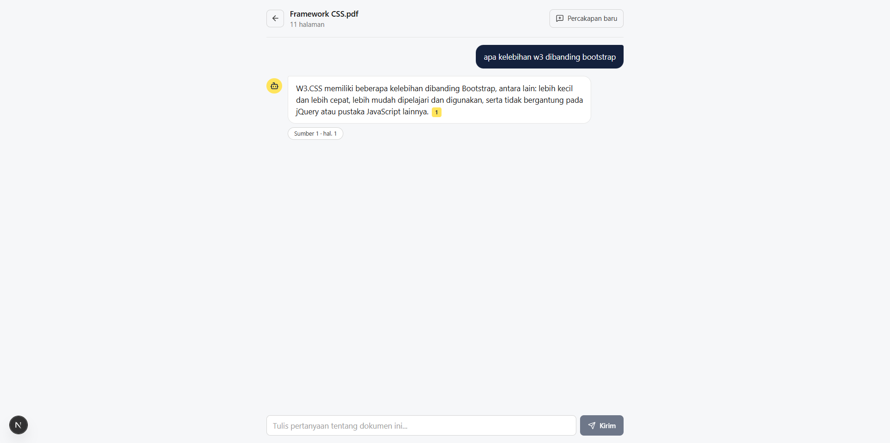
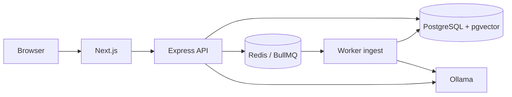

# RAG Docs

Tanya jawab dokumen PDF dengan kutipan sumber per halaman. Unggah PDF, ajukan pertanyaan, dan dapatkan jawaban yang hanya bersumber dari isi dokumen. Seluruh model AI berjalan lokal lewat Ollama, tanpa API berbayar.


## Screenshot




## Fitur

- Registrasi dan login dengan JWT; dokumen dan percakapan tiap user terpisah
- CRUD dokumen: unggah PDF, lihat daftar, ganti nama, hapus (beserta chunk, riwayat chat, dan file)
- Pemrosesan PDF di latar belakang dengan antrean BullMQ (status: diproses, siap, gagal)
- Teks dipotong menjadi chunk dengan overlap, di-embed dengan bge-m3 dan disimpan di pgvector
- Jawaban dialirkan (streaming) dengan penanda sumber [1] [2] yang bisa diklik untuk melihat halaman asalnya
- Menolak menjawab bila informasinya tidak ada di dokumen (ambang skor kemiripan)
- Unit test dengan Vitest dan CI GitHub Actions

## Arsitektur



Alur unggah: PDF disimpan, job masuk antrean, worker mengekstrak teks per halaman, memotongnya menjadi chunk, membuat embedding, lalu menyimpannya ke database.
Alur tanya: pertanyaan di-embed, chunk terdekat dicari dengan pgvector, lalu model chat menjawab dari chunk tersebut saja.

## Teknologi

- Frontend: Next.js 16, React 19, Tailwind CSS 4
- Backend: Node.js, Express 5, TypeScript, BullMQ, Zod, Vitest
- Database: PostgreSQL 16 dengan pgvector, Redis 7
- AI: Ollama (embedding bge-m3, chat qwen2.5:3b)

## Menjalankan secara lokal

Prasyarat: Node.js 22, Docker, Ollama.

1. Jalankan database dan Redis: `docker compose up -d`
2. Buat tabel: jalankan isi `backend/sql/001_init.sql` lalu `backend/sql/002_embedding_1024.sql` pada database `ragdocs`
   - Linux/macOS: `docker compose exec -T db psql -U raguser -d ragdocs < backend/sql/001_init.sql`
   - PowerShell: `Get-Content backend/sql/001_init.sql | docker compose exec -T db psql -U raguser -d ragdocs`
   - Ulangi perintah yang sama untuk `backend/sql/002_embedding_1024.sql`
3. Tarik model: `ollama pull bge-m3` dan `ollama pull qwen2.5:3b`
4. Salin `backend/.env.example` menjadi `backend/.env`, lalu ganti `JWT_SECRET`
5. Backend: `cd backend && npm install && npm run dev` (port 3001)
6. Frontend: `cd frontend && npm install && npm run dev` (port 3000)
7. Buka http://localhost:3000

## Test

```
cd backend
npm test
```

## Struktur folder

- backend/src/routes: endpoint auth, dokumen, dan chat
- backend/src/lib: ingest, embeddings, retrieval, LLM, operasi dokumen
- backend/src/worker.ts: worker pemrosesan PDF
- backend/sql: skema database
- backend/tests: unit test
- frontend/src/app: halaman login, daftar dokumen, dan chat